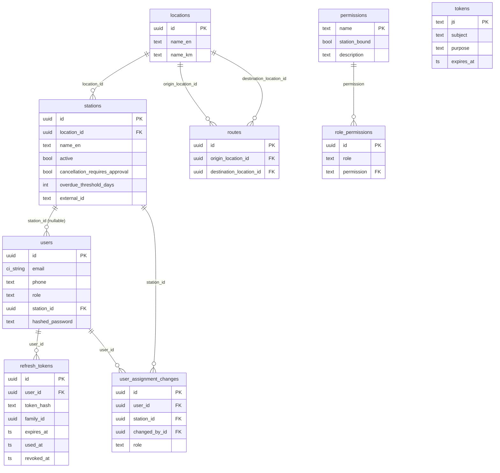
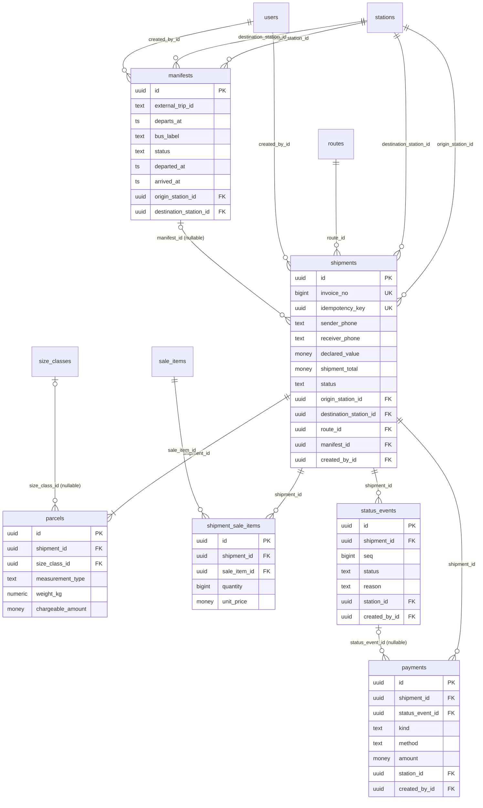
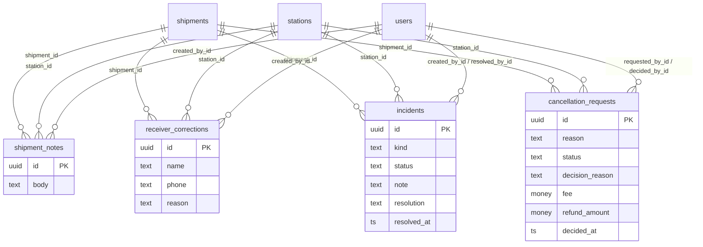
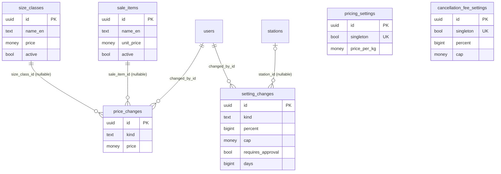

# Entity relationship diagram

Generated from the live `ex_dev` schema (foreign keys read from `information_schema`), 26 tables. Render with any Mermaid viewer (GitHub, VS Code "Markdown Preview Mermaid Support").

Conventions: uuid primary keys, `inserted_at` on every table, money columns are `money_with_currency` (KHR), enums are plain `text`. Column lists show the important columns only; audit columns (`inserted_at`, `created_by_id`) are omitted where noted.

## 1. Network and people

`tokens` (AshAuthentication token store) has no foreign key; `subject` is the user reference as text. `role` is an enum in `users` and `role_permissions`, not a table.

## 2. Shipping core

`shipments.status` is stored on the row as well as in the `status_events` history (`status_events` is the source of truth; unique `seq` per shipment). `shipment_sale_items.unit_price` and `parcels.chargeable_amount` are price snapshots taken at sale time.

## 3. Shipment follow-ups (all append-only or resolve-once)

## 4. Pricing and settings

`pricing_settings` and `cancellation_fee_settings` are single-row tables (`singleton` unique). Every change to prices or settings also writes a row to `price_changes` / `setting_changes`.

## Notes for the scale-up plan

- **Biggest growth tables:** `shipments`, `status_events`, `payments`, `parcels`, `refresh_tokens`. `refresh_tokens` and `tokens` need an expiry cleanup job; the rest are long-term records.
- **Hot join paths:** station -> shipments (origin and destination), shipment -> status_events, manifest -> shipments. Index these foreign keys and check them with `pgbot`'s `suggest_indexes` on real data.
- **Read replicas later:** reports and list screens read `shipments` + `status_events`; writes stay on the primary.
- **Partitioning candidates later (not now):** `status_events` and `payments` by month, once they are in the tens of millions of rows.
