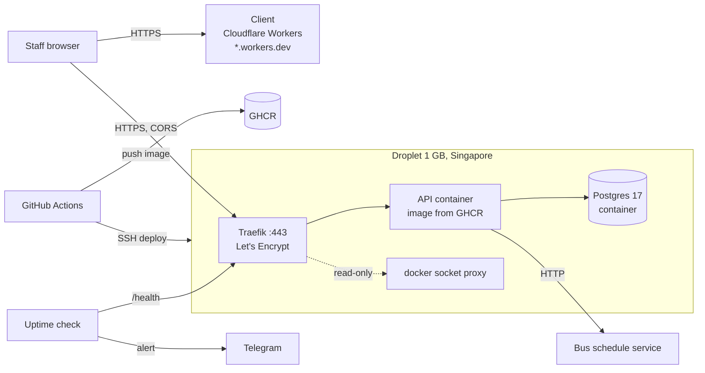
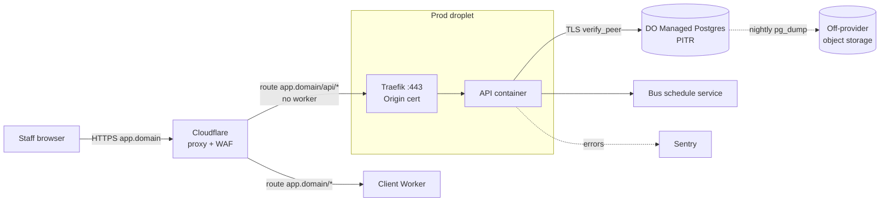
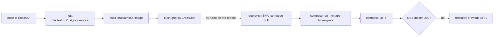
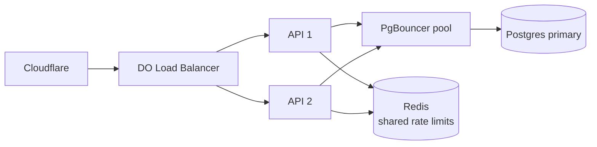

# System design

Status: agreed for Phase A (test), planned for Phase B (launch). Capacity numbers are rough estimates, not measurements; load test before relying on them (see "Validation"). The step-by-step runbook is `docs/deployment.md`.

## 1. What the system is

A parcel-by-bus platform: staff at stations register shipments, put them on bus manifests, track status, take payments, and handle cancellations and incidents. Staff use a React web client; everything goes through one JSON:API.

This document covers the **API side**: the Phoenix + Ash server, its database, and how it is built, deployed and scaled. The client (TanStack Start) is built and deployed separately to Cloudflare Workers (ADR-0011); this document only fixes how it reaches the API.

## 2. Two phases

| | Phase A: test (now) | Phase B: launch (later) |
|---|---|---|
| Purpose | Testers only, no real customer data | Real stations and customers |
| Hostname | Droplet IP `159.223.95.98` (no domain yet) | Real domain behind Cloudflare |
| TLS | None: plain HTTP on port 80 (`APP_ENTRYPOINT=web`), testers only | Cloudflare proxy, SSL mode Full (strict), Let's Encrypt from `server/deploy/docker-compose.yml` (`APP_ENTRYPOINT=websecure`) |
| Server | One DO Droplet, Singapore, 1 GB + 2 GB swap | Prod droplet (sized from Phase B numbers); the Phase A droplet becomes staging |
| Database | `postgres:17-alpine` container on the droplet | DO Managed Postgres, `DATABASE_SSL=true`, `verify_peer` with DO's CA |
| Firewall | DO cloud firewall: 22 (key only), 443 | 22 (key only), 443 from Cloudflare IP ranges only |
| Client → API | Cross-origin, CORS allow-list | Same origin through a Workers route; CORS removed |
| Client IP for rate limits | Right-most untrusted `x-forwarded-for` | `CF-Connecting-IP` |
| Backups | None (test data is disposable) | PITR + nightly `pg_dump` to another provider |
| Error tracking | Logs only | Sentry (free tier) |
| API docs (`/api/docs`, `/api/v1/open_api`) | On | Off |

Phase B starts when a real domain is bought and the numbers in section 9 are known. See ADR-0010.

### Phase A

### Phase B

## 3. Principles for scale

1. **Stateless app tier.** Any request can hit any server. Do not add local state that must survive a request (files, sessions, in-memory queues).
2. **Postgres is the system of record and the first bottleneck.** Protect it: indexes, pagination, connection budget, then replicas.
3. **Slow work leaves the request path.** Reports, notifications, schedule syncs and exports go to a job queue once they exist (ADR-0012).
4. **Idempotent writes.** `shipments.idempotency_key` already exists; keep that pattern for any create that a client may retry (payments next).
5. **Make cheap things stay cheap.** Add a component only when a measured limit says so.
6. **Everything that changes is backward compatible for one release.** Database migrations and the API contract are additive: add, switch over, remove later. The old container keeps running while migrations run, a rollback does not undo a migration, and the client deploys on its own schedule.

## 4. Build and deploy

Images are built only by CI; the droplet never compiles anything. Secrets are set by hand on the droplet and never pass through CI (ADR-0009).

- For now CI only tests and builds; deploying is done by hand on the droplet with `server/deploy/deploy.sh <SHA>`. Automatic deploy of `release/*` to the test droplet (and later staging) can be added back as a CI job that runs the same script over SSH.
- Prod (Phase B) is deployed by hand by choosing a SHA that has already passed on staging. Image tags are SHAs and are never reused.
- The droplet runs `image: ghcr.io/<owner>/ex:${TAG}` and never builds. It pulls with a GitHub token that has only `read:packages`.
- Migrations run as their own step, before the new container takes traffic. Seeding is not part of startup; the first Admin is created once by hand.
- Order between the two deploy targets: an API change the client needs ships first, and the API stays compatible with the client version that is live.

## 5. Edge, TLS and client access

- **Traefik** is the only process listening publicly (80, and 443 from Phase B). It reaches Docker through a read-only socket proxy, not the raw `docker.sock`, and its version is pinned.
- No container publishes a host port except Traefik. (The local compose file maps `4001:4000` for development; `server/deploy/docker-compose.yml` publishes none.)
- **Phase A TLS:** none. Traefik serves the IP on the `web` entrypoint; the client's Vite dev server proxies `/api` there. The temporary droplet-IP exceptions in `server/config/prod.exs` (plain HTTP and `check_origin`) stay until Phase B.
- **Phase B TLS:** Cloudflare proxy, Full (strict), Let's Encrypt from `server/deploy/docker-compose.yml` (`APP_ENTRYPOINT=websecure`; HTTP-01 needs `/.well-known/acme-challenge` reachable on port 80 through Cloudflare; `acme.json` on the `letsencrypt` volume). Origin Certificate rejected in ADR-0010.
- **Client access (ADR-0011):**
  - Phase A: a CORS plug in `server/lib/ex_web/endpoint.ex`, before the router, so preflight requests are answered before the rate limiter. Exact allowed origins come from runtime config (worker URL, preview URLs, localhost). Allows the `Authorization` header, `max_age` 7200, no credentials mode (bearer tokens).
  - Phase B: a Workers **route** sends `app.domain/*` to the client worker and `app.domain/api/*` to the origin with no worker. Not a Workers Custom Domain, which would capture `/api` too. Same origin, so CORS is removed.

## 6. Scaling stages (Phase B and after)

### Stage 1: launch

One prod droplet, Managed Postgres, Cloudflare in front. `POOL_SIZE` set so `pool x containers` stays inside the database plan's connection limit (about 22 usable on the smallest plan), keeping a few for `bin/migrate` and manual sessions.

### Stage 2: first growth (trigger: sustained CPU > 60% or p95 latency rising)

- Two or more API nodes behind a load balancer. No code change, because the API is stateless.
- **Redis** for Hammer: ETS counters are per node, so limits multiply with node count. Redis arrives with the second node, not before.
- **Connection budget:** `POOL_SIZE x nodes` below the database limit; PgBouncer (transaction mode) when it gets tight.
- Cache hot, rarely changing reads (permissions, roles, reference data, pricing) with short TTLs and invalidate on write.
- Cluster the nodes (`dns_cluster` is already a dependency) only if PubSub across nodes is needed.

### Stage 3: high traffic (trigger: primary DB CPU or connections saturated after tuning)

- Read replica(s) for lists, reports and search; writes stay on the primary. Route reads explicitly per action and accept replica lag on report screens only.
- Monthly partitions for `status_events` and `payments` once they reach tens of millions of rows; archive old partitions.
- Autoscaling or Kubernetes only if traffic is spiky. Not before.

## 7. Cross-cutting design

**Security.**
- Secrets live only in `/opt/ex/server/.env` on the droplet (owned by `deploy`, mode 600), with a copy in a password manager. No default credentials anywhere: a missing `SEED_*` or `DASHBOARD_*` value makes the feature fail closed, not fall back to a known password.
- SSH by key only, no root login, unattended security upgrades. Membership in the `docker` group is effectively root, so the `deploy` user limits mistakes but is not a security boundary.
- `/ops/dashboard` is not reachable from the internet; open it through `ssh -L`.
- Rate limits at three levels (IP, auth endpoints, account). The client IP comes from one setting: right-most untrusted `x-forwarded-for` in Phase A, `CF-Connecting-IP` in Phase B. The header is trustworthy in Phase B only because the firewall admits Cloudflare alone.
- Changing `TOKEN_SIGNING_SECRET` signs everyone out.

**Background work (ADR-0012).** `AshAuthentication.Supervisor` already removes expired `tokens`. A small periodic GenServer deletes expired `refresh_tokens` with an idempotent `DELETE`, so it is safe when several nodes run it. Oban (AshOban) arrives with the first real retryable job, such as SMS or Telegram notifications.

**Data lifecycle.** Keep `shipments`, `status_events`, `payments` indefinitely; plan partitioning before they are large, because converting later needs a migration window.

**Observability.**
- Phase A: free external uptime check on `/health` alerting to Telegram; Docker log rotation in `/etc/docker/daemon.json` (`json-file`, `max-size 10m`, `max-file 3`) so it covers every container; LiveDashboard over an SSH tunnel; `recon` for live diagnosis.
- Phase B adds: Sentry, structured JSON logs with request id, p95/p99 latency and DB pool queue time, alerts on 5xx rate, DB connections and disk. Use `pgbot` (`top_queries`, `suggest_indexes`, `vacuum_health`) once real traffic exists.

**Reliability (Phase B targets).**
- Recovery point: at most about 5 minutes of lost data (Managed Postgres point-in-time recovery).
- Recovery time: about 2 hours (new droplet, CI deploy, `.env` from the password manager).
- A nightly `pg_dump` is copied to object storage at a different provider (for example Backblaze B2), in case the DigitalOcean account itself is lost or locked.
- One restore drill before launch.
- Rollback means redeploying the previous SHA; additive migrations make that safe.
- Build large indexes `concurrently` (see `docs/database-health.md`).

**API behaviour under load.** Paginate every list (keyset for the big tables). Cap page size. Return 429 with `retry-after` (done). Keep request timeouts short and fail fast to protect the DB pool.

## 8. Capacity guess and validation

Rough expectation, unmeasured: a single small droplet should serve a few hundred simple requests per second; shipment creation (several inserts in a transaction) will be far lower. With `RELEASE_MODE=interactive` the release uses about 150-170 MB; a 1 GB droplet with 2 GB swap holds the app, Postgres, Traefik and a migrate container at once.

Before Phase B:
1. Load test with `k6`: login, list shipments, create shipment, status update, at 2x expected peak (morning departures).
2. Watch DB pool queue time, p95 latency and CPU; find the first limit.
3. Fix the limit (index, query, pool, size) and repeat. Record results in this doc.

## 9. Open before Phase B

| Question | Why it matters |
|---|---|
| Stations, staff, shipments per day now and in a year | Sizes the prod droplet, database plan and `POOL_SIZE` |
| Time of the first bus departure | Sets the morning peak and the safe deploy window |
| Monthly infrastructure budget | Picks the droplet and database plans |
| Real domain | Cloudflare zone, Let's Encrypt on Traefik, Workers route |

## 10. Work list

Phase A (code changes, separate from this document):
1. GitHub Actions workflow: test with a Postgres service, build `linux/amd64`, push to GHCR by SHA, SSH deploy with migrate step and `/health` check, rollback to previous SHA.
2. ~~Server compose for the droplet.~~ Done: `server/deploy/docker-compose.yml`, switched by `/etc/ex/<env>.env`. Still open: docker socket proxy.
3. ~~Remove `seed` from the container command and the fallback `SEED_*` / `DASHBOARD_*` values from `server/docker-compose.yml`.~~ Done.
4. Phase B: remove the temporary droplet-IP entries from `server/config/prod.exs` (`check_origin`, `force_ssl` host exclusions).
5. CORS plug in the endpoint with a runtime origin allow-list.
6. Rate-limit client IP: one runtime setting, right-most untrusted `x-forwarded-for` (Phase A) or `CF-Connecting-IP` (Phase B).
7. Periodic GenServer that deletes expired `refresh_tokens`.
8. ~~Gate `/api/docs` and `/api/v1/open_api` behind a runtime flag (on in test, off in prod).~~ Done.
9. ~~Make `/ops/dashboard` unreachable through Traefik.~~ Done.
10. Droplet setup: `deploy` user, swap, firewall, unattended upgrades, Docker log rotation, uptime check to Telegram.
11. ~~`RELEASE_COOKIE` from `.env`; the cookie built into the public image is known.~~ Done.

Phase B:
1. Domain, Cloudflare zone, Full (strict), `/etc/ex/prod.env` with `APP_ENTRYPOINT=websecure`, Workers route for `/api/*`, remove CORS.
2. Managed Postgres with `verify_peer` (`server/config/runtime.exs:45` uses `verify_none` today), PITR, nightly off-provider dump, restore drill.
3. Firewall 443 to Cloudflare ranges, switch rate-limit IP setting to `CF-Connecting-IP`, and add Traefik `--entrypoints.websecure.forwardedHeaders.trustedIPs=<Cloudflare ranges>` (the old traefik.yml had it).
4. Sentry, structured logs, alerts. Load test.
