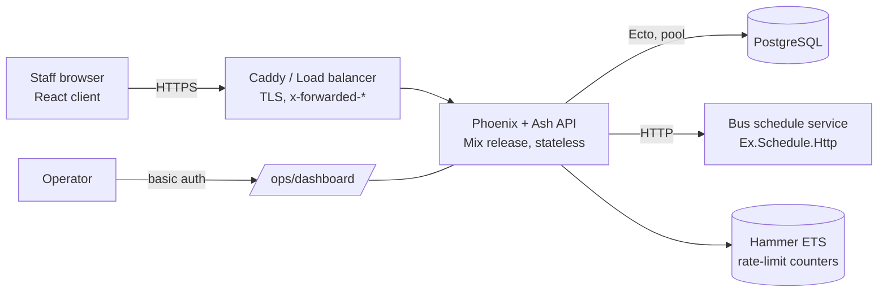
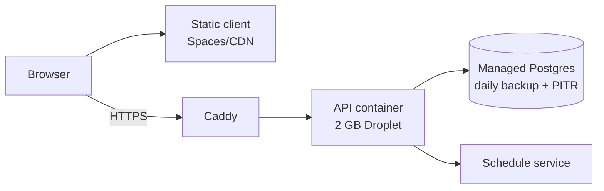
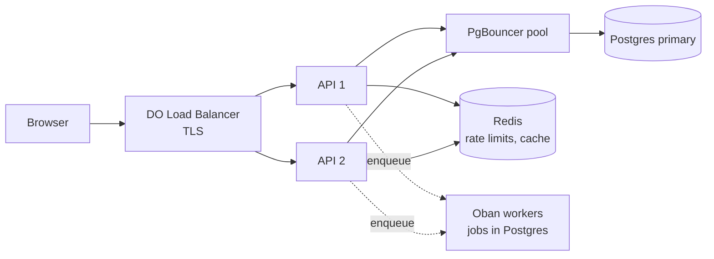

# System design

Status: proposal. Describes what exists today and the stages for growth. Capacity numbers are rough estimates, not measurements; load test before relying on them (see "Validation").

## 1. What the system is

A parcel-by-bus platform: staff at stations register shipments, put them on bus manifests, track status, take payments, and handle cancellations and incidents. Staff use a React web client; everything goes through one JSON:API.

## 2. Current architecture (built)

| Concern | Today |
|---|---|
| API | Phoenix + Ash, JSON:API under `/api/v1`, OpenAPI at `/api/open_api`, Scalar docs at `/api/docs` |
| Auth | AshAuthentication: short-lived bearer access token + rotating refresh token (`refresh_tokens`, family + reuse detection) |
| Authorization | Permissions as data (`permissions`, `role_permissions`); `HasPermission` check plus a station-scope check |
| Rate limiting | Per-IP 300/min, sign-in/refresh 10/min (plug), per-account sign-in 5 per 15 min (AshRateLimiter); Hammer ETS, per node |
| Data | One Postgres, uuid keys, KHR money, append-only history tables (see `docs/erd.md`) |
| Ops | LiveDashboard at `/ops/dashboard` behind basic auth; `/health` checks the DB |
| Packaging | `Dockerfile` builds a Mix release; `bin/migrate`, `bin/server` |

Design rules already in force: stateless API (no server session), money never floats, history written in the same transaction as the change, append-only enforced by both Ash (no update/destroy action) and Postgres triggers.

## 3. Principles for scale

1. **Stateless app tier.** Any request can hit any server. Do not add local state that must survive a request (files, sessions, in-memory queues).
2. **Postgres is the system of record and the first bottleneck.** Protect it: indexes, pagination, connection budget, then replicas.
3. **Slow work leaves the request path.** Reports, emails, schedule syncs, exports go to a job queue.
4. **Idempotent writes.** `shipments.idempotency_key` already exists; keep that pattern for any create that a client may retry (payments next).
5. **Make cheap things stay cheap.** Add a component only when a measured limit says so.

## 4. Staged plan

### Stage 1: MVP launch

- One Droplet (2 GB), Docker, Caddy for TLS, `--restart unless-stopped`.
- Managed Postgres, `DATABASE_SSL=true`, `POOL_SIZE` 10.
- Client built to static files and served from a CDN, not the API.
- Monitoring: uptime check on `/health`, error tracking, `/ops/dashboard`.
- Deploy: build `linux/amd64` image, push to registry, `bin/migrate`, restart, check `/health`.
- Firewall: 22 (your IP only if possible), 80, 443.

### Stage 2: first growth (trigger: sustained CPU > 60% or p95 latency rising)

- Two or more API nodes behind a load balancer. No code change needed because the API is stateless.
- **Shared rate limiter:** switch Hammer to the Redis backend; ETS counts are per node, so limits multiply with node count.
- **Oban** for background work and scheduled jobs (expired token cleanup, schedule sync, exports).
- **Connection budget:** `POOL_SIZE x nodes` below the database limit; use PgBouncer (transaction mode) when it gets tight.
- Cache hot, rarely changing reads (permissions, roles, reference data, pricing) with short TTLs and invalidate on write.
- Optional: cluster the nodes (`dns_cluster` is already a dependency) if you later need PubSub across nodes.

### Stage 3: high traffic (trigger: primary DB CPU or connections saturated after tuning)

- Read replica(s) for lists, reports and search; writes stay on the primary. Route reads explicitly per action, accept replica lag on report screens only.
- Table partitioning by month for `status_events` and `payments` once in the tens of millions of rows; archive old partitions.
- Autoscaling (instance pool) or Kubernetes only if traffic is spiky. Not before.
- Move search/reporting to a separate store only if Postgres full-text and replicas stop being enough.

## 5. Cross-cutting design

**Security.** TLS at the edge; `force_ssl` trusts `x-forwarded-proto`. Secrets only in environment (`SECRET_KEY_BASE`, `TOKEN_SIGNING_SECRET`, `DATABASE_URL`, `DASHBOARD_*`). Rotate by redeploy; changing the signing secret signs everyone out. Rate limits at three levels (IP, auth endpoints, account). Known gap: `assent` advisory (not reachable, no OAuth in use).

**Data lifecycle.** Delete expired `refresh_tokens` and `tokens` on a schedule (not done yet). Keep `shipments`, `status_events`, `payments` indefinitely; plan partitioning before they are large, because converting later needs a migration window.

**Observability.** Telemetry already exposed to LiveDashboard. Add: structured JSON logs with request id, error tracker, p95/p99 latency and DB pool queue time, alerts on `/health`, 5xx rate, DB connections and disk. Use `pgbot` (`top_queries`, `suggest_indexes`, `vacuum_health`) after real traffic exists.

**Reliability.** Backups: managed daily plus point-in-time recovery; do a restore test before launch. Deploy: migrate before the new version takes traffic; migrations must be backward compatible with the previous release (add column, then use it, then drop later). Build large indexes `concurrently`. Rollback = redeploy previous image tag, so keep images tagged by git SHA.

**API behaviour under load.** Paginate every list (keyset for the big tables). Cap page size. Return 429 with `retry-after` (done). Keep request timeouts short and fail fast to protect the DB pool.

**Environments.** dev (local Postgres, `/dev` dashboard), staging (same Droplet type, separate DB, optional), prod. Same image across all.

## 6. Capacity guess and validation

Rough expectation, unmeasured: a 2 GB Droplet running this API against a small managed Postgres should serve a few hundred simple requests per second; shipment creation (several inserts in a transaction) will be far lower. The release holds about 300 MB of VM memory at idle, of which about 35 MB is the Unicode collation table loaded by a dependency.

Before launch:
1. Load test with `k6`: login, list shipments, create shipment, status update, at 2x expected peak.
2. Watch DB pool queue time, p95 latency and CPU; find the first limit.
3. Fix the limit (index, query, pool, size) and repeat. Record results in this doc.

## 7. Open decisions

| Decision | Options | Needed to decide |
|---|---|---|
| Hosting | Droplet + Caddy (recommended) or App Platform | domain, how much ops you want |
| Database | Managed Postgres (recommended) or container on the Droplet | budget, data-loss tolerance |
| Shared rate limit | Redis at stage 2 or accept looser limits | when a second node is added |
| Job queue | Oban (Postgres) | first slow job appearing |
| Expected load | users, requests per second now and in a year | needed to size stage 1 |

## 8. Immediate work list

1. Write prod `docker-compose.yml`, `Caddyfile`, deploy script (stage 1).
2. Expiry cleanup job for `refresh_tokens` / `tokens`.
3. Check foreign-key and list-query indexes with `pgbot`.
4. Confirm pagination and max page size on all list endpoints.
5. Reconcile `shipments.status` (stored column) with `docs/schema.md` ("never stored").
6. Load test plan with `k6`.
7. Fix stale note in `docs/deployment.md` (Docker is installed; image never built yet).
